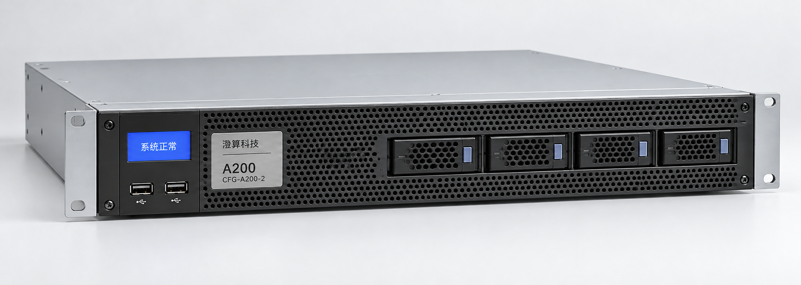

# A200两卡版正面

A200 两卡正面照片，铭牌可见 CFG-A200-2。

> 资料快照：2026-08-20；整理日期：2026-11-04。状态与结论仅适用于所引证据的时间、版本和范围。

原始资料：[IMG-003_A200两卡版正面.png](../../raw/图片素材/IMG-003_A200两卡版正面.png)

提取方式：本轮直接视觉阅读；下文为 Agent 对可见信息的整理，未运行独立 OCR 服务。

## 视觉提取

可见“澄算科技”“A200”“CFG-A200-2”铭牌、显示“系统正常”的前面板屏幕、两个 USB 外形接口、前部盘位及通风孔。

照片不能证明内部加速卡数量、内存容量、性能或客户运行状态。配置规格来自 [PROD-001 · A200 推理一体机产品与配置说明](PROD-001.md)；此图不是四卡版内部照片。

关联：[A200推理一体机](../entities/A200推理一体机.md)、[图片证据与多模态资料](../concepts/图片证据与多模态资料.md)。

## 引用本页

- [图片证据与多模态资料](../concepts/图片证据与多模态资料.md)
- [A200推理一体机](../entities/A200推理一体机.md)
- [PROD-001 · A200 推理一体机产品与配置说明](PROD-001.md)

[返回知识索引](../index.md)
