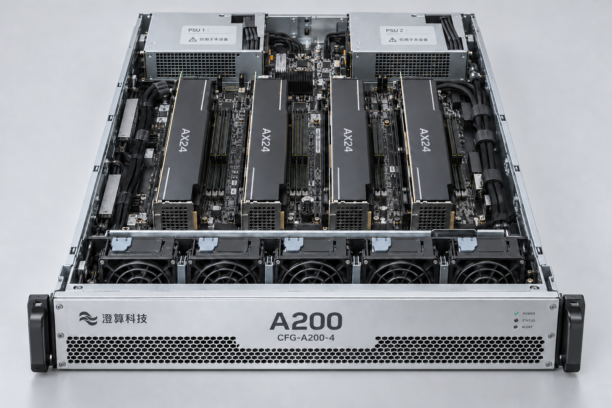

# A200四卡版内部

A200 四卡内部照片，可见四块 AX24 标识卡及配置铭牌。

> 资料快照：2026-08-20；整理日期：2026-11-04。状态与结论仅适用于所引证据的时间、版本和范围。

原始资料：[IMG-004_A200四卡版内部.png](../../raw/图片素材/IMG-004_A200四卡版内部.png)

提取方式：本轮直接视觉阅读；下文为 Agent 对可见信息的整理，未运行独立 OCR 服务。

## 视觉提取

可见“CFG-A200-4”前面板铭牌、四块标有 AX24 的卡、前部风扇排列和后部两处 PSU 标识部件。

不能仅靠照片确认显存、系统内存、可用性或电源冗余能力；正式参数按 [PROD-001 · A200 推理一体机产品与配置说明](PROD-001.md)。

关联：[A200推理一体机](../entities/A200推理一体机.md)、[图片证据与多模态资料](../concepts/图片证据与多模态资料.md)。

## 引用本页

- [图片证据与多模态资料](../concepts/图片证据与多模态资料.md)
- [A200推理一体机](../entities/A200推理一体机.md)
- [PROD-001 · A200 推理一体机产品与配置说明](PROD-001.md)

[返回知识索引](../index.md)
