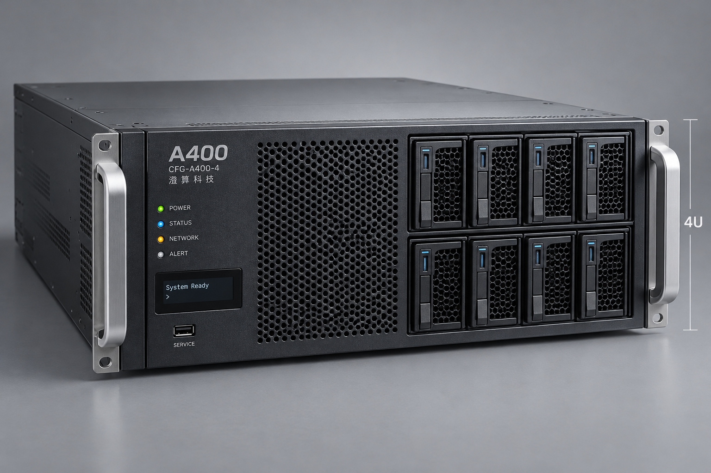

# A400四卡版正面

A400 四卡正面照片，含 CFG-A400-4 与 4U 标识。

> 资料快照：2026-08-20；整理日期：2026-11-04。状态与结论仅适用于所引证据的时间、版本和范围。

原始资料：[IMG-005_A400四卡版正面.png](../../raw/图片素材/IMG-005_A400四卡版正面.png)

提取方式：本轮直接视觉阅读；下文为 Agent 对可见信息的整理，未运行独立 OCR 服务。

## 视觉提取

可见“A400”“CFG-A400-4”“澄算科技”、4U 高度标注、上下两排前部盘位、POWER／STATUS／NETWORK／ALERT 指示标签、System Ready 屏幕及 SERVICE 接口。

照片没有验证内部加速卡、实际磁盘容量或模型性能；规格按 [PROD-002 · A400 推理一体机产品与配置说明](PROD-002.md)。

关联：[A400推理一体机](../entities/A400推理一体机.md)、[图片证据与多模态资料](../concepts/图片证据与多模态资料.md)。

## 引用本页

- [图片证据与多模态资料](../concepts/图片证据与多模态资料.md)
- [A400推理一体机](../entities/A400推理一体机.md)
- [PROD-002 · A400 推理一体机产品与配置说明](PROD-002.md)

[返回知识索引](../index.md)
