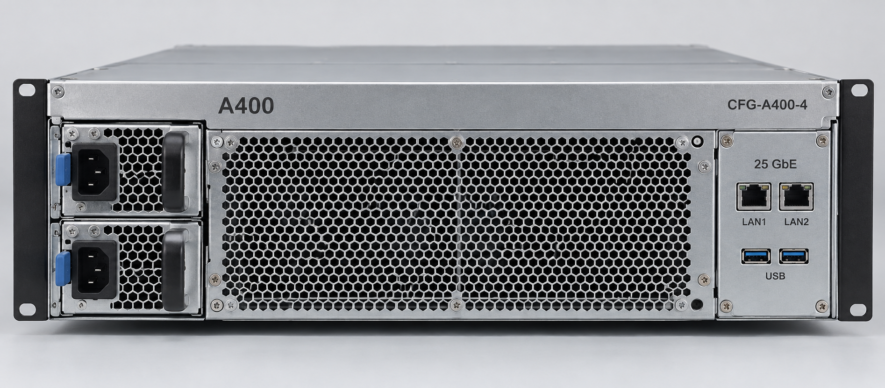

# A400后面板接口

A400 后面板照片，两个 LAN 与 USB 接口及电源模块位置。

> 资料快照：2026-08-20；整理日期：2026-11-04。状态与结论仅适用于所引证据的时间、版本和范围。

原始资料：[IMG-006_A400后面板接口.png](../../raw/图片素材/IMG-006_A400后面板接口.png)

提取方式：本轮直接视觉阅读；下文为 Agent 对可见信息的整理，未运行独立 OCR 服务。

## 视觉提取

可见“CFG-A400-4”，右侧“25 GbE”、LAN1／LAN2 标注和两个网络口，下方两个 USB 口；左侧上下两组电源模块外观，中部通风区。

“25 GbE”是图中标识，实际链路速率与连通性未测；不能据此推导完整接口清单或电源冗余承诺。配置依据 [PROD-002 · A400 推理一体机产品与配置说明](PROD-002.md)。

关联：[A400推理一体机](../entities/A400推理一体机.md)、[图片证据与多模态资料](../concepts/图片证据与多模态资料.md)。

## 引用本页

- [图片证据与多模态资料](../concepts/图片证据与多模态资料.md)
- [A400推理一体机](../entities/A400推理一体机.md)
- [PROD-002 · A400 推理一体机产品与配置说明](PROD-002.md)

[返回知识索引](../index.md)
