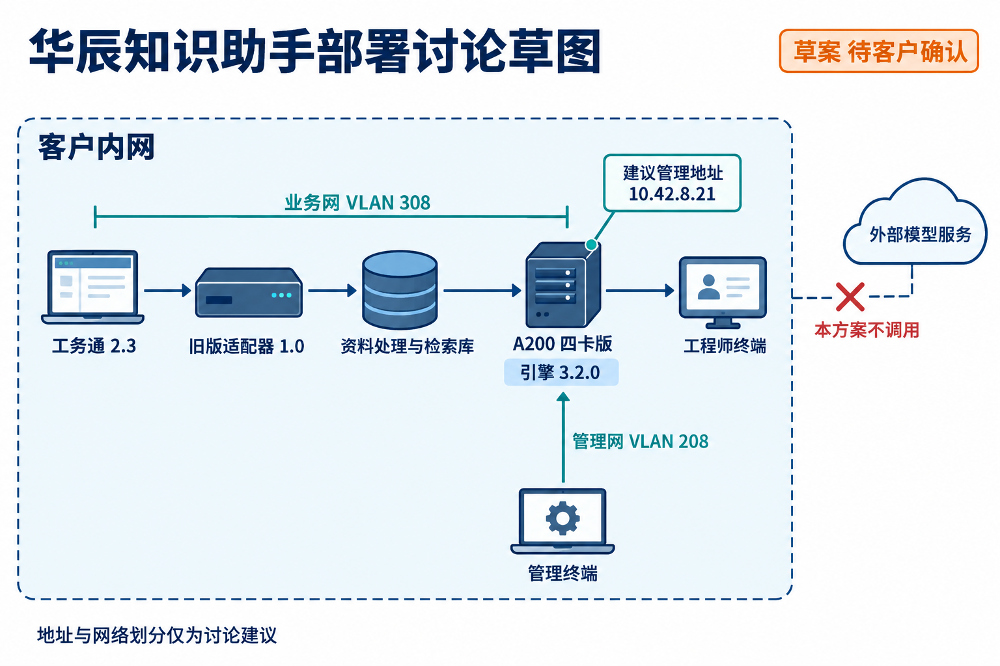

# 华辰部署讨论草图

华辰部署草案：业务 VLAN 308、管理 VLAN 208 和建议 IP，均待确认。

> 资料快照：2026-08-20；整理日期：2026-11-04。状态与结论仅适用于所引证据的时间、版本和范围。

原始资料：[IMG-007_华辰部署讨论草图.png](../../raw/图片素材/IMG-007_华辰部署讨论草图.png)

提取方式：本轮直接视觉阅读；下文为 Agent 对可见信息的整理，未运行独立 OCR 服务。

## 图形与文字提取

标注“草案 待客户确认”，客户内网内的逻辑流为：工务通 2.3 → 旧版适配器 1.0 → 资料处理与检索库 → A200 四卡版（引擎 3.2.0）→ 工程师终端。

业务网标注 VLAN 308，管理终端经管理网 VLAN 208 指向设备，建议管理地址 10.42.8.21。外部模型服务旁有叉号，标注“本方案不调用”。图底部说明地址与网络划分仅为讨论建议。

这是逻辑讨论图，不证明现场拓扑、IP 分配、端口可达或系统已部署。无客户确认不能把建议地址写成实际地址。

关联：[SOL-002 · 华辰精工知识助手八月选型评审](SOL-002.md)、[华辰精工](../entities/华辰精工.md)、[软件兼容与现场验收](../concepts/软件兼容与现场验收.md)、[图片证据与多模态资料](../concepts/图片证据与多模态资料.md)。

## 引用本页

- [图片证据与多模态资料](../concepts/图片证据与多模态资料.md)
- [软件兼容与现场验收](../concepts/软件兼容与现场验收.md)
- [华辰精工](../entities/华辰精工.md)
- [SOL-002 · 华辰精工知识助手八月选型评审](SOL-002.md)

[返回知识索引](../index.md)
