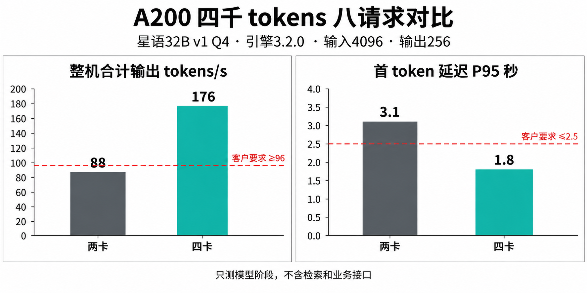

# A200性能对比

A200 4K／八请求的吞吐和延迟对比，与华辰门槛对应。

> 资料快照：2026-08-20；整理日期：2026-11-04。状态与结论仅适用于所引证据的时间、版本和范围。

原始资料：[IMG-008_A200性能对比.png](../../raw/图片素材/IMG-008_A200性能对比.png)

提取方式：本轮直接视觉阅读；下文为 Agent 对可见信息的整理，未运行独立 OCR 服务。

## 图表提取

星语 32B v1 Q4、引擎 3.2.0、输入 4096、输出 256、八请求。两卡整机合计 88 tokens/s、首 token P95 3.1 秒；四卡为 176 tokens/s、1.8 秒。红色参考线为客户要求 ≥96 tokens/s、≤2.5 秒。

图注明确只测模型阶段，不含检索和业务接口。数值与 [TEST-001 · A200 星语 32B 性能测试报告](TEST-001.md) 的 A2-4K-8、A4-4K-8 一致，门槛来自 [CUST-001 · 华辰精工知识助手商机与需求记录](CUST-001.md)；不是新的独立实验，也不是其他客户的默认验收标准。

关联：[性能选型与验收口径](../concepts/性能选型与验收口径.md)、[A200推理一体机](../entities/A200推理一体机.md)、[华辰精工](../entities/华辰精工.md)。

## 引用本页

- [图片证据与多模态资料](../concepts/图片证据与多模态资料.md)
- [性能选型与验收口径](../concepts/性能选型与验收口径.md)
- [华辰精工](../entities/华辰精工.md)
- [TEST-001 · A200 星语 32B 性能测试报告](TEST-001.md)

[返回知识索引](../index.md)
