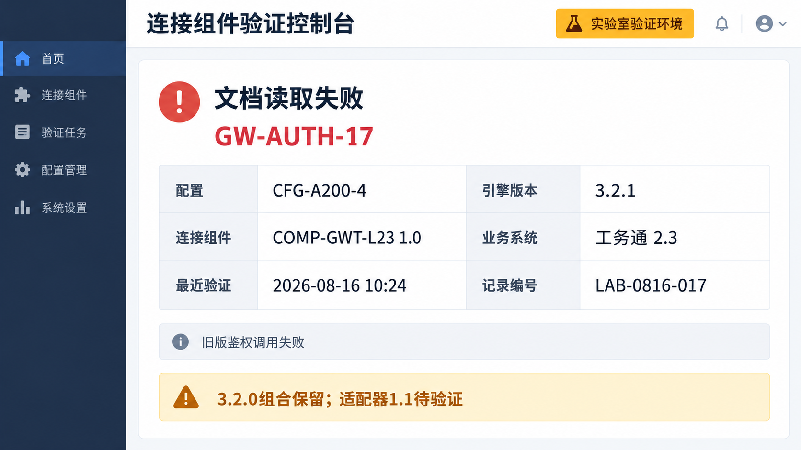

# 旧版适配器故障界面

实验室鉴权故障截图：GW-AUTH-17 与 LAB-0816-017。

> 资料快照：2026-08-20；整理日期：2026-11-04。状态与结论仅适用于所引证据的时间、版本和范围。

原始资料：[IMG-009_旧版适配器故障界面.png](../../raw/图片素材/IMG-009_旧版适配器故障界面.png)

提取方式：本轮直接视觉阅读；下文为 Agent 对可见信息的整理，未运行独立 OCR 服务。

## 可见文字提取

连接组件验证控制台，标注“实验室验证环境”；文档读取失败，GW-AUTH-17，旧版鉴权调用失败。

| 字段 | 可见值 |
| --- | --- |
| 配置 | CFG-A200-4 |
| 引擎版本 | 3.2.1 |
| 连接组件 | COMP-GWT-L23 1.0 |
| 业务系统 | 工务通 2.3 |
| 最近验证 | 2026-08-16 10:24 |
| 记录编号 | LAB-0816-017 |

底部提示“3.2.0 组合保留；适配器 1.1 待验证”。[SALES-003 · 推理引擎升级与旧版适配器销售沟通通知](SALES-003.md) 中的问题编号 ISSUE-017 与截图记录编号 LAB-0816-017 含义不同，不合并成同一 ID。截图不证明任何客户现场已经故障。

关联：[引擎升级风险与项目影响](../concepts/引擎升级风险与项目影响.md)、[澄算推理引擎](../entities/澄算推理引擎.md)、[工务通旧版适配器](../entities/工务通旧版适配器.md)、[图片证据与多模态资料](../concepts/图片证据与多模态资料.md)。

## 引用本页

- [图片证据与多模态资料](../concepts/图片证据与多模态资料.md)
- [引擎升级风险与项目影响](../concepts/引擎升级风险与项目影响.md)
- [澄算推理引擎](../entities/澄算推理引擎.md)
- [SALES-003 · 推理引擎升级与旧版适配器销售沟通通知](SALES-003.md)

[返回知识索引](../index.md)
